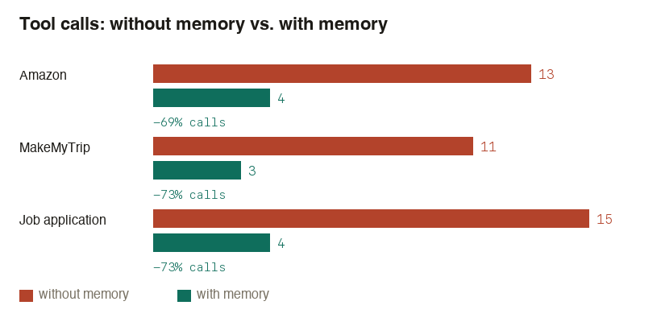

System Design 

[soon]

## Recall benchmarks

Demo video (real sites, three tasks, no memory vs. with memory, stopped before any
purchase/payment/submission): https://claude.ai/artifact/GnVWHfjsEmZyQ7mDazoVph



Tool-call counts are real and measured directly. See the artifact above for the full
breakdown, including token estimates and their methodology.

### Running the memory system

```sh
docker-compose up -d                          # redis, rabbitmq, qdrant
cargo run --bin rabbitmq-setup                # declares exchange/queues (once per fresh rabbitmq)
cargo build --release                         # capture, recall, + the rabbitmq-* tools
cd learn && uv sync && ./.venv/bin/learn      # starts the async consumer
```

Needs `OPENROUTER_API_KEY` set for `learn`'s LLM calls.

### What was tested

Three real tasks, each run once with no prior memory and once with Groove's learned data:

- **amazon.in** — search for a product, add it to the cart
- **makemytrip.com** — search for a flight, open its fare details
- **job-boards.greenhouse.io** (a real public job posting) — fill in name, email, phone

### HMT and AWM, and where each one showed up

- **AWM** (`learn/src/learn/awm/workflow.py`) induces a reusable, ready-made workflow (a
  short list of `{key, value}` steps) from a successful run on a site, and matches a new
  prompt against it. On Amazon and MakeMyTrip, AWM's matched workflow is what gave the
  navigate-time hint its exact step list.
- **HMT** (`learn/src/learn/hmt/site_tree.py`, `stage_llm.py`) segments a run into named
  stages with pre/post-conditions, and picks the next stage live by combining semantic
  similarity to the task with how well a stage's start condition follows from what's
  already done. This is the fallback when AWM has no confident match, and also the
  per-tool-call "what's done, what's next" tracking during a run.
- **Facts** (`learn/src/learn/facts.py`) are simpler: saved personal values (name, email,
  phone, etc.) matched against a form field's label. This is what filled the job
  application without the prompt ever stating who the applicant was.

